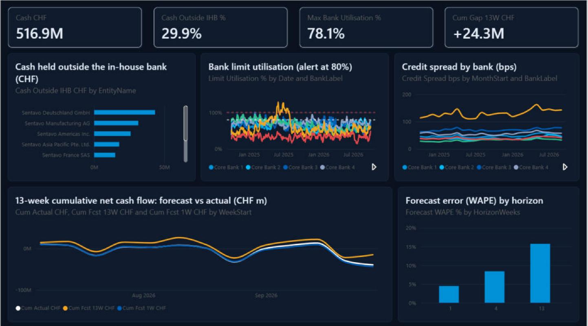

# Treasury Control Tower: liquidity, bank limits and forecast quality (Power BI)

A one-page Power BI report for a corporate Group Treasury, built on a synthetic dataset. It answers three questions a treasurer asks every week: where is our cash, are we inside our bank limits, and can we trust the 13-week forecast?

I can't share real treasury data, so the company is fictional and everything is generated. The model and measures are the same kind I'd use on real data.



> **Disclaimer.** Sentavo Industrial Group AG is fictional. All data was generated by `src/generate_data.py`. No real company, bank, client or market data is used. Banks are anonymised by role (Core Bank 1–4, Regional Bank CH/PL/SG), and interest-rate and FX paths are illustrative.

## What the page shows

| Visual | What it answers |
|---|---|
| KPI strip | Cash (CHF 516.9m), share held outside the in-house bank (29.9%), highest bank utilisation today (78.1%), 13-week cumulative gap between forecast and actual (+CHF 24.3m) |
| Cash held outside the in-house bank | Which entities hold cash that isn't pooled at the holding |
| Bank limit utilisation | Daily exposure against each bank's limit, with the 80% alert line and the 100% limit |
| Credit spread by bank | Monthly spread in bps, to read next to utilisation |
| 13-week cumulative net cash flow | Actual vs the 1-week-ahead and 13-week-ahead forecast over the last 13 weeks |
| Forecast error (WAPE) by horizon | How accuracy decays at 1, 4 and 13 weeks |

## What I found in the data

- **A limit breach that was visible weeks earlier.** The small Polish bank (Regional Bank PL, limit CHF 12m, BBB+) goes above 80% utilisation on 3 March 2025. It first exceeds its limit 12 weeks later, on 27 May 2025, and peaks at CHF 15.4m (129% of limit) on 3 June. It stays over the limit for 41 business days. Its credit spread is also the widest and rising: 115 bps at the start, 139 bps at the end, against 30–73 bps for the other banks. The cause is cash building up at the Polish subsidiary, which reaches about 2.4x its January level at the peak.
- **A third of the cash sits outside the in-house bank.** CHF 154m of CHF 517m is held at entities other than the holding, which is the starting point for a cash pooling or concentration review.
- **Forecast accuracy decays with distance, and receipts are optimistic.** WAPE is 4.5% at one week, 8.4% at four weeks and 15.7% at 13 weeks. Customer receipts are forecast 5.3% too high at the 13-week horizon. Over the last 13 weeks the 13-week-ahead forecast shows a cumulative net outflow of CHF 14.8m where the actual was CHF 39.1m.

These come from scenarios I built into the generator, so the data has something to find (see below). The point is the model and the measures, not the story.

## Data model

Star schema, CHF reporting currency, October 2024 to September 2026 (business days). A `Date` table is created in Power BI. The model loads all source tables; the page uses `FactLiquidityPosition`, `DimBank`, `DimEntity`, `FactCreditSpreads` and `FactCashForecast`. The deposit, money-market-fund, FX and bank-fee tables are loaded and related, but I haven't built report pages on them yet.

| Table | Grain | Key columns |
|---|---|---|
| `DimEntity` | Group entity | EntityKey, country, functional currency, role |
| `DimBank` | Bank counterparty | BankKey, tier, rating, outlook, counterparty limit (CHF) |
| `DimFund` | Money market fund | FundKey, sponsor bank, currency, fund type, rating |
| `DimCurrency` | Currency | CurrencyCode |
| `FactLiquidityPosition` | Day × entity × bank/fund × instrument × currency | Balance_LC, Balance_CHF |
| `FactTermDeposits` | Deposit deal | principal, start/maturity, tenor, rate, interest |
| `FactMMFYield` | Day × fund | 7-day yield |
| `FactDepositQuotes` | Month × bank × currency × tenor | quoted rate |
| `FactFXDeals` | FX deal | pair, type, tenor, notional (base & CHF), spread, channel |
| `FactBankFees` | Month × bank × fee category | amount CHF |
| `FactBankIssues` | Service issue | area, severity, open/close dates, status, resolution days |
| `FactCreditSpreads` | Day × bank | credit spread (bps, synthetic) |
| `FactCashForecast` | Week × entity × flow category × horizon | forecast vs actual (CHF) |
| `MarketBenchmarkRates` | Day × benchmark | SARON / €STR / SOFR (illustrative) |
| `MarketFXRates` | Day × currency | CHF per unit (illustrative) |

## Measures

All 24 measures are in [`dax/measures.dax`](dax/measures.dax), grouped as Liquidity, Counterparty risk and Forecast. The ones worth a look:

- **Snapshot measures.** Cash and bank exposure take the last date in the filter context instead of summing balances over time. On a card that is the as-of date, and on a daily line chart each point is that day, so one `Limit Utilisation %` measure drives both.
- **Bank exposure counts bank balances only.** Money market fund positions are excluded through `CounterpartyType`, so they don't count against a bank limit.
- **WAPE uses one base.** The denominator is always the 1-week actuals, so errors at 1, 4 and 13 weeks are comparable. The actual is repeated on each horizon row, so actuals are read from the 1-week rows to avoid counting them three times.
- **Net cash flow excludes intercompany**, which nets to zero at group level.
- **Cumulative forecast lines** remove the date filter and rebuild it, so each point is the running total from the start of the 13-week window.

`src/reconcile_dashboard.py` recomputes the headline figures from the CSV files with pandas, independently of DAX:

```bash
python src/reconcile_dashboard.py data
```

## Scenarios built into the data

- **Local limit breach.** Cash builds up at the Polish subsidiary in H1 2025 and breaches the local bank's limit from late May to end of July 2025. It is then up-streamed to the holding.
- **Dividend season.** The holding runs down CHF balances, EUR deposits and EUR MMFs ahead of the April dividend payment.
- **CHF deposits run off.** Once SARON reaches zero in mid-2025, CHF term deposits are no longer worth placing, and the balance moves to notice and current accounts.
- **Deposit policy.** New deposits are only placed up to 80% of a bank's limit, so exposure above 80% comes from operating balances and FX moves, not from new placements.
- **Credit spread stress.** A market-wide widening in April 2025 that decays over the following weeks. One bank with a positive outlook tightens over the period, and the local Polish bank widens.
- **Bank fees.** One core bank raises its payment tariffs in January 2026, and another renegotiates connectivity fees in July 2025.
- **Forecast quality.** Forecast error grows with the horizon (1, 4 and 13 weeks), and customer receipts carry an optimism bias.

## Repository structure

```
data/    sentavo_treasury_dataset.xlsx and one CSV per table
dax/     measures.dax: all measures
src/     generate_data.py (fixed seed) and reconcile_dashboard.py
report/  Sentavo_Treasury_Dashboard.pbix, dashboard.png, treasury_dark_theme.json
```

## Run it

Open `report/Sentavo_Treasury_Dashboard.pbix` in Power BI Desktop. The data is imported into the file, so it opens without any setup. To refresh, repoint the queries to `data/sentavo_treasury_dataset.xlsx` under Transform data → Data source settings. The theme is also in `report/` if you want to reuse it.

To regenerate the data:

```bash
pip install pandas numpy openpyxl
python src/generate_data.py
```

## Tools

Power BI Desktop (Power Query, DAX, themes), Python (pandas, NumPy).
