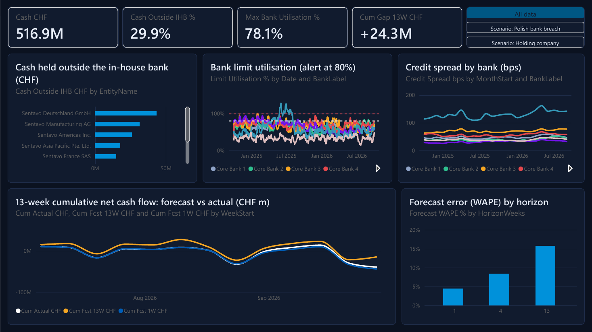

# Treasury Control Tower: liquidity, bank limits, budget and forecast quality (Power BI)

A five-page Power BI report for a corporate Group Treasury, built on a synthetic dataset. It answers the questions a treasurer asks every week and every month: where is our cash, are we inside our bank limits, can we trust the 13-week forecast, how is the treasury result tracking against budget, what do our banks cost us, and are we placing deposits at good rates?

I can't share real treasury data, so the company is fictional and everything is generated. The model, the measures and the checks are the same kind I'd use on real data.



> **Disclaimer.** Sentavo Industrial Group AG is fictional. All data was generated by `src/generate_data.py`. No real company, bank, client or market data is used. Banks are anonymised by role (Core Bank 1–4, Regional Bank CH/PL/SG), interest-rate and FX paths are illustrative, and the users in the security table are fictional.

## Report pages

| Page | What it answers | Built with |
|---|---|---|
| [1 Treasury Control Tower](report/screenshots/1_treasury_control_tower.png) | Cash, cash outside the in-house bank, bank limit utilisation, credit spreads, 13-week forecast vs actual and forecast error by horizon | Snapshot measures, cumulative windows, single-base WAPE |
| [2 Budget vs Actual](report/screenshots/2_budget_vs_actual.png) | Treasury result (interest income, bank fees, FX cost) against budget and the latest reforecast, by month, line and entity, with full-year outturn and a written variance commentary | Time intelligence, a calculation group for Actual / Budget / Forecast / Variance / Variance %, dynamic commentary in DAX |
| [3 Bank Fees & Service](report/screenshots/3_bank_fees_and_service.png) | Fees by bank and category against the prior year, lasting price changes, open issues and days to resolve | Year-on-year and rolling 3-month measures, drill-through to a bank detail page |
| [4 Deposits & MMFs](report/screenshots/4_deposits_and_mmfs.png) | Maturity ladder, placed rate against bank quotes and the benchmark, money market fund yield and concentration | `USERELATIONSHIP` on the inactive maturity-date relationship |
| [5 Data Quality](report/screenshots/5_data_quality.png) | Key, value and security checks, and the README figures recalculated in DAX | Calculated tables evaluated at refresh |
| Bank Detail (drill-through) | Monthly fees by category and the issue log for one bank | Drill-through on `DimBank[BankLabel]` |

Row-level security has two roles on `DimEntity`: a static *Entity CFO – Poland* role and a dynamic *Entity CFO (dynamic)* role that reads a user-to-entity table with `USERPRINCIPALNAME()`. [Viewed as the Polish CFO](report/screenshots/6_row_level_security_view_as.png), the report shows CHF 9.7m of cash at one entity and two banks instead of CHF 517m across the group.

## What I found in the data

- **A limit breach that was visible weeks earlier.** The small Polish bank (Regional Bank PL, limit CHF 12m, BBB+) goes above 80% utilisation on 3 March 2025. It first exceeds its limit 12 weeks later, on 27 May 2025, and peaks at CHF 15.4m (129% of limit) on 3 June. It is over the limit on 41 business days, in five separate episodes between 27 May and 30 July, so a daily check would have raised it five times. Its credit spread is also the widest and rising: 115 bps at the start, 139 bps at the end. Core Bank 3 also touched 101% of its limit for one day, on 31 January 2025.
- **A third of the cash sits outside the in-house bank.** CHF 154m of CHF 517m is held at entities other than the holding, which is the starting point for a cash pooling or concentration review.
- **Forecast accuracy decays with distance, and receipts are optimistic.** WAPE is 4.5% at one week, 8.4% at four weeks and 15.7% at 13 weeks. Customer receipts are forecast 5.3% too high at 13 weeks. Over the last 13 weeks the 13-week-ahead forecast showed a cumulative net outflow of CHF 14.8m where the actual was CHF 39.1m.
- **The budget assumed rates would hold, and they didn't.** 2025 interest income was CHF 7.16m against a budget of CHF 9.76m, because SARON and €STR were cut through the year. In 2026 to September the treasury result is CHF 3.28m against CHF 4.09m budgeted, CHF 0.82m (20%) short, and interest income explains CHF 0.87m of it. The full-year outturn (actuals to September plus the Q2 reforecast) is CHF 4.30m against a budget of CHF 5.46m.
- **Total bank fees look flat, but two banks moved.** Fees for January to September 2026 are 1.3% above the prior year and 0.6% under budget. Underneath, Core Bank 3's payment fees are 35% higher after its January tariff increase (16% over its fee budget), and Core Bank 1's connectivity fees are 17% lower after the July 2025 renegotiation. A rolling 3-month comparison flags exactly these two and no noise.
- **Deposits are placed slightly below the best quote.** Weighted by principal, deposits were placed 3.7 bps below the best quote for the same month, currency and tenor, and 3.9 bps above the benchmark. Three in four deals did not get the best quote of the month, which is the case for a quote-comparison check before each placement. CHF 132.2m is outstanding, maturing between October 2026 and August 2027.

These come from scenarios built into the generator, so the data has something to find (see below). The point is the model, the measures and the checks, not the story.

## How the figures are checked

Every figure in this README is calculated three times, independently:

| Where | How | Run |
|---|---|---|
| DAX, in the report | The measures on the pages. The *Data Quality* page also recalculates ten headline figures at refresh and compares them with this README. | Open the report |
| SQL | DuckDB views over the CSV files in [`sql/`](sql). `src/run_sql_checks.py` compares every README figure with the SQL result and runs the data-quality checks. | `python src/run_sql_checks.py` |
| pandas | `src/reconcile_dashboard.py` recomputes the same figures with pandas. | `python src/reconcile_dashboard.py data` |

`pytest` compares SQL with pandas for every figure and both with the values in [`src/expected_figures.py`](src/expected_figures.py), which are the numbers quoted above. It also checks that the P&L actuals tie back to the fee and FX deal tables, that the reforecasts carry actuals for closed months, and that the fee step-change view finds exactly the two built-in price changes. If the README and the data drift apart, a test fails.

```bash
pip install -r requirements.txt
python -m pytest -q          # 82 tests
```

## SQL layer

The views in [`sql/`](sql) read the CSV files directly (DuckDB, no server):

| File | Views |
|---|---|
| `01_bank_exposure.sql` | Daily bank exposure and limit utilisation, daily group cash |
| `02_limit_breach_episodes.sql` | Breach episodes as gaps and islands (`LAG` and a running count), and the weeks of warning between the 80% alert and the breach |
| `03_bank_fees.sql` | Fees against the same month a year earlier (`LAG(..., 12)`), step changes on a rolling 3-month window, service quality by bank |
| `04_budget_variance.sql` | Year-to-date and full-year outturn against budget, monthly variance by entity |
| `05_forecast_quality.sql` | WAPE by horizon, receipts bias, cumulative net cash flow over the last 13 weeks |
| `06_data_quality.sql` | Orphan keys, negative balances, duplicates and other checks, table row counts |
| `07_deposits.sql` | Deposit pricing against the best quote and the benchmark, maturity ladder |

## Data model

Star schema, CHF reporting currency, October 2024 to September 2026 (business days). The `Date` table is created in DAX, marked as a date table and runs from January 2024 to December 2027, so full budget years and deposits maturing in 2027 are covered. All queries read one workbook through a `DataFile` parameter.

| Table | Grain | Key columns |
|---|---|---|
| `DimEntity` | Group entity | EntityKey, country, functional currency, role |
| `DimBank` | Bank counterparty | BankKey, tier, rating, outlook, counterparty limit (CHF) |
| `DimFund` | Money market fund | FundKey, sponsor bank, currency, fund type, rating |
| `DimCurrency` | Currency | CurrencyCode |
| `DimScenario` | Plan scenario | Actual, Budget, Forecast Q1, Forecast Q2 |
| `FactLiquidityPosition` | Day × entity × bank/fund × instrument × currency | Balance_LC, Balance_CHF |
| `FactTermDeposits` | Deposit deal | principal, start/maturity, tenor, rate, interest |
| `FactMMFYield` | Day × fund | 7-day yield |
| `FactDepositQuotes` | Month × bank × currency × tenor | quoted rate |
| `FactFXDeals` | FX deal | pair, type, tenor, notional (base & CHF), spread, channel |
| `FactBankFees` | Month × bank × fee category | amount CHF |
| `FactBankIssues` | Service issue | area, severity, open/close dates, status, resolution days |
| `FactCreditSpreads` | Day × bank | credit spread (bps, synthetic) |
| `FactCashForecast` | Week × entity × flow category × horizon | forecast vs actual (CHF) |
| `FactTreasuryPnL` | Month × scenario × entity × bank × line × category | amount CHF (income positive, cost negative) |
| `SecurityUserEntity` | User × entity | user principal name, EntityKey (for dynamic RLS, not related) |
| `MarketBenchmarkRates` | Day × benchmark | SARON / €STR / SOFR (illustrative) |
| `MarketFXRates` | Day × currency | CHF per unit (illustrative) |

The treasury P&L is built from the other tables, so actuals tie back to them: interest income accrues daily on term deposits, money market funds and notice accounts, bank fees come from the fee table (allocated to entities by the accounts they hold at each bank), and FX cost is half the spread on each deal. Each budget is built in the autumn before the year on the run rate of the three months before, with rates held flat, fees +2% and FX volumes +3%. The Q1 and Q2 reforecasts carry actuals for closed months and the latest quarter's run rate for the rest.

## Measures

88 measures in eight display folders, plus a calculation group and two roles. The model is saved as a Power BI Project, so every measure is a text file under [`report/Sentavo_Treasury_Dashboard.SemanticModel/definition`](report/Sentavo_Treasury_Dashboard.SemanticModel/definition). [`dax/measures.dax`](dax/measures.dax) is a readable copy. The ones worth a look:

- **Snapshot measures.** Cash and bank exposure take the last date in the filter context instead of summing balances over time. On a card that is the as-of date, and on a daily line chart each point is that day.
- **WAPE uses one base.** The denominator is always the 1-week actuals, so errors at 1, 4 and 13 weeks are comparable.
- **Year to date stops at the last close.** YTD, prior-year and full-year measures end at the last month with booked actuals, so budget is only compared for closed months, and a card with no date filter still shows the current year.
- **Calculation group.** *Scenario View* switches the P&L measures between Actual, Budget, the latest forecast, Variance and Variance %, with its own format string for the percentage. It applies only to the P&L measures (`ISSELECTEDMEASURE`), so it can't change anything else on the page.
- **`USERELATIONSHIP`.** Deposits are related to the date table on start date (active) and maturity date (inactive). The maturity ladder switches to the maturity date inside the measure.
- **Rolling 3-month fee change.** Comparing three months with the same three months a year earlier removes monthly noise, so only lasting price changes cross the ±15% band. The measure stays blank until a full prior-year window exists.
- **Variance commentary.** The commentary on the budget page is written by DAX: the result against budget, the line with the largest variance and the bank most over its fee budget.

## Scenarios built into the data

- **Local limit breach.** Cash builds up at the Polish subsidiary in H1 2025 and breaches the local bank's limit from late May to end of July 2025. It is then up-streamed to the holding.
- **Dividend season.** The holding runs down CHF balances, EUR deposits and EUR MMFs ahead of the April dividend payment.
- **CHF deposits run off.** Once SARON reaches zero in mid-2025, CHF term deposits are no longer worth placing, and the balance moves to notice and current accounts.
- **Deposit policy.** New deposits are only placed up to 80% of a bank's limit, so exposure above 80% comes from operating balances and FX moves, not from new placements.
- **Credit spread stress.** A market-wide widening in April 2025 that decays over the following weeks. One bank with a positive outlook tightens over the period, and the local Polish bank widens.
- **Bank fees.** Core Bank 3 raises its payment tariffs in January 2026, and Core Bank 1 renegotiates connectivity fees in July 2025.
- **Forecast quality.** Forecast error grows with the horizon (1, 4 and 13 weeks), and customer receipts carry an optimism bias.
- **Budget.** The budgets hold interest rates flat and don't know about the Core Bank 3 tariff increase.

## Repository structure

```
data/    sentavo_treasury_dataset.xlsx and one CSV per table
dax/     measures.dax: readable copy of the measures, calculation group and roles
report/  Sentavo_Treasury_Dashboard.pbip (Power BI Project: model and pages as text)
         Sentavo_Treasury_Dashboard.pbix (the same report as one file)
         screenshots/, treasury_dark_theme.json
sql/     DuckDB views
src/     generate_data.py (fixed seed), reconcile_dashboard.py (pandas),
         run_sql_checks.py (SQL), expected_figures.py (the README figures)
tests/   pytest
```

## Run it

Open `report/Sentavo_Treasury_Dashboard.pbip` (or the `.pbix`) in Power BI Desktop. The data is imported, so it opens without setup. To refresh, set the `DataFile` parameter (Transform data → Edit parameters) to `data/sentavo_treasury_dataset.xlsx` in your copy of the repository. To see the security roles, use Modeling → View as, for example *Entity CFO (dynamic)* with the user `cfo.pl@sentavo.example`.

```bash
pip install -r requirements.txt
python src/generate_data.py           # regenerate the data (fixed seed)
python src/run_sql_checks.py          # SQL checks against the README figures
python src/reconcile_dashboard.py data
python -m pytest -q
```

## Tools

Power BI Desktop (Power Query, DAX, TMDL, Power BI Project format, row-level security), SQL (DuckDB), Python (pandas, NumPy, pytest).
